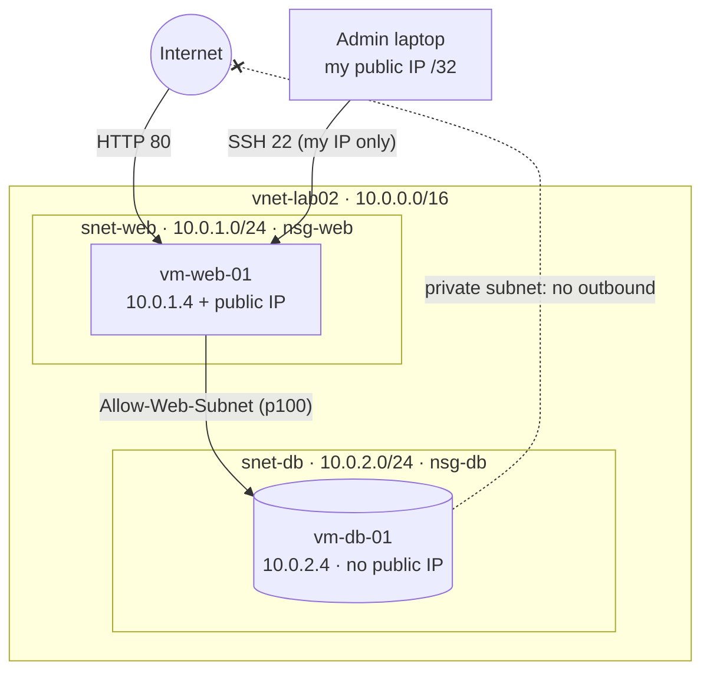

# Lab 7: Secure 2-Tier Web Application on Azure

A classic IaaS pattern built two ways: once by hand in the Azure portal, then again as **Terraform**. A public web tier and a private database tier sit in one VNet, and Network Security Groups decide who can talk to whom.

The interesting part isn't the build. The original SOP's "lock down the database" step **didn't actually restrict anything**, and this repo documents why and how to fix it.

---

## Architecture



### Three layers of defense on the database

| Layer | Control | Effect |
|---|---|---|
| 1 | No public IP | No route from the internet to the DB |
| 2 | Private subnet (`default_outbound_access_enabled = false`) | The DB can't reach the internet either |
| 3 | `nsg-db` with explicit Deny | Even inside the VNet, only the web subnet gets in |

### The NSG rules on `nsg-db` (evaluated lowest number first, first match wins)

| Priority | Name | Source | Action | Notes |
|---|---|---|---|---|
| 100 | Allow-Web-Subnet | 10.0.1.0/24 | Allow | Production: limit to 3306 / 5432 |
| 4000 | Deny-VNet-Inbound | VirtualNetwork | **Deny** | **The fix.** Not in the original SOP |
| 65000 | AllowVnetInBound | VirtualNetwork | Allow | Azure default, now never reached |
| 65500 | DenyAllInBound | Any | Deny | Azure default |

> **Why the Deny matters:** Azure's built-in rule 65000 already allows every subnet in a VNet to reach every other subnet. Adding only an Allow for the web subnet changes nothing, because that traffic was already allowed. The Deny at 4000 is what turns the NSG into a default-deny boundary.

---

## What's in this repo

```
.
├── README.md                     ← you are here
├── terraform/
│   ├── providers.tf              azurerm ~> 4.0, http ~> 3.4
│   ├── variables.tf              RG, SSH key, VM size, tags, db_allow_web toggle
│   ├── main.tf                   VNet, subnets, NSGs, public IP, NICs, VMs, auto-shutdown
│   ├── outputs.tf                IPs + ready-to-paste SSH commands
│   └── terraform.tfvars.example  copy to terraform.tfvars
└── docs/
    ├── portal-runbook.md         the click-through version, corrected
    └── troubleshooting.md        every issue actually hit, with fixes
```

---

## Deploy with Terraform

### Prerequisites

- Terraform ≥ 1.5 and Azure CLI (`brew install terraform azure-cli`)
- An **existing** resource group. Terraform reads it and never creates or deletes it.
- An **existing** SSH public key resource in that RG, with its private `.pem` in `~/.ssh/`

### Steps

```bash
az login
az account set --subscription <your-subscription-id>

cd terraform
cp terraform.tfvars.example terraform.tfvars   # fill in your subscription ID
terraform init
terraform validate
terraform plan -out=lab.tfplan                 # expect: 14 to add
terraform apply lab.tfplan
```

> **PowerShell users:** quote flags that contain a dot or equals sign, for example `terraform plan "-out=lab.tfplan"`. Otherwise PowerShell splits the argument and Terraform reports *"Too many command line arguments."*

About 75 seconds later you'll have 14 resources and outputs like:

```
web_public_ip      = "x.x.x.x"
web_private_ip     = "10.0.1.4"
db_private_ip      = "10.0.2.4"
ssh_allowed_from   = "<your-ip>/32"
ssh_to_web         = "ssh -i ~/.ssh/key-lab02.pem azureuser@x.x.x.x"
ssh_to_db_via_jump = "ssh -J azureuser@x.x.x.x azureuser@10.0.2.4"
```

### Design choices

- **Existing RG as a data source.** Built for a shared subscription: everything lands in one RG you own, and `terraform destroy` can't remove the RG itself.
- **SSH locked to your current IP** via `api.ipify.org` at plan time. No `0.0.0.0/0` on port 22.
- **Static private IPs** (`.4` in each subnet) so the tests are deterministic.
- **NSGs attached at the subnet level,** so any future VM in a tier inherits the tier's rules.
- **Auto-shutdown at 22:00 ET** on both VMs, to protect a shared budget.
- **Ubuntu 24.04 LTS.** The original SOP used 20.04, which is past end of standard support.

---

## Verify (positive and negative)

A rule you haven't tested is just a guess, so test it both ways.

**1. Web tier → DB is allowed**

```bash
ssh -i ~/.ssh/key-lab02.pem azureuser@<web_public_ip>
hostname -I                  # 10.0.1.4
ping -c 4 10.0.2.4           # 0% packet loss, ~1.5 ms
nc -zv -w 5 10.0.2.4 22      # succeeded!
```

**2. Jump to the DB without copying your key**

```bash
ssh-add ~/.ssh/key-lab02.pem
ssh -J azureuser@<web_public_ip> azureuser@10.0.2.4
curl -m 5 https://www.microsoft.com   # times out (private subnet, no outbound)
```

> Never copy a private key onto an internet-facing server. `ProxyJump` tunnels through the web VM while the key stays on your laptop.

**3. Negative test: flip the rule in code**

```bash
terraform apply -var="db_allow_web=false"   # 1 to change: Allow → Deny
# from vm-web-01: ping -c 4 10.0.2.4  →  100% packet loss
terraform apply                              # 1 to change: Deny → Allow
# from vm-web-01: ping -c 4 10.0.2.4  →  0% packet loss
```

Same traffic, one variable changed, opposite result. That's proof the NSG is enforcing the boundary.

---

## Clean up

```bash
terraform destroy        # expect: 14 to destroy (RG and SSH key are untouched)
ssh-keygen -R 10.0.2.4   # clear host keys so the next rebuild doesn't warn
ssh-keygen -R <web_public_ip>
az resource list -g <your-rg> -o table   # only the SSH key should remain
```

---

## Lessons learned

1. **An Allow on top of an Allow restricts nothing.** Know the default rules before you write your own.
2. **Portal defaults are choices you didn't make.** Picking "Custom" for an NSG rule pre-fills port **8080**. On the portal run, that silently scoped the Allow rule to 8080, so ping and SSH fell through to the Deny.
3. **Test both directions.** 0% loss with Allow and 100% with Deny is the proof. Either result alone isn't.
4. **Wait before you troubleshoot.** A TCP check timed out right after the fresh deploy, then succeeded a few minutes later with no changes made. `az vm run-command` and `az network watcher test-ip-flow` confirmed every layer was fine before anything was "fixed."
5. **`REMOTE HOST IDENTIFICATION HAS CHANGED` is expected after a rebuild** that reuses an IP. Confirm *why* it changed before running `ssh-keygen -R`.
6. **Ubuntu 24.04 shows `ssh.service` as inactive.** That's socket activation: `ssh.socket` holds port 22 and starts the service on demand.

See [`docs/troubleshooting.md`](docs/troubleshooting.md) for the full list.

---

## What I'd do next

- Replace public SSH with **Azure Bastion**
- Use **Application Security Groups** so rules say "web → db" instead of CIDR ranges
- Turn on **NSG flow logs** and Traffic Analytics
- Tighten `Allow-Web-Subnet` to the actual database port (3306 / 5432)
- Add a remote backend (Azure Storage) for Terraform state, plus a CI pipeline running `fmt`, `validate`, and `plan` on pull requests

---

*Part of an ongoing home-lab series building out cloud skills in public.*
